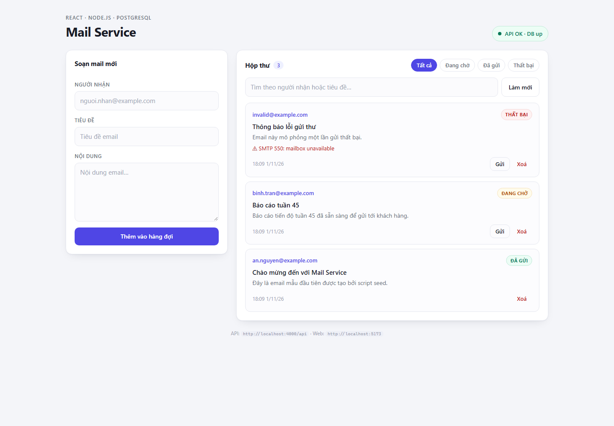
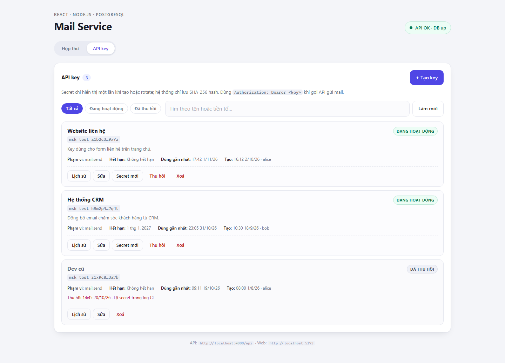
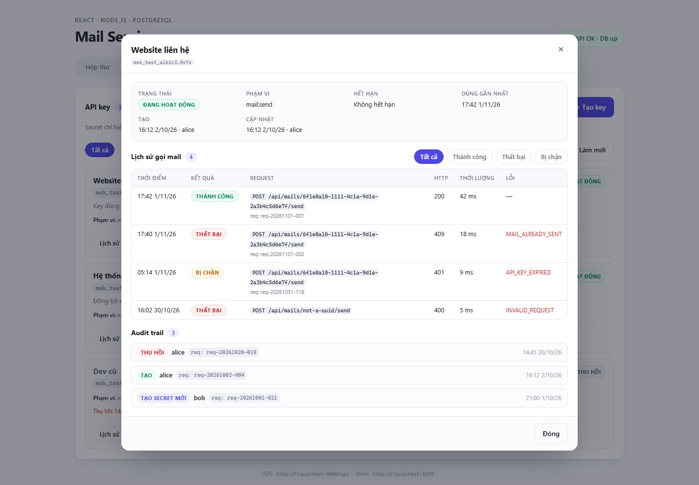

# Mail Service

Monorepo khởi tạo cho dịch vụ gửi mail: **React (Vite + TypeScript)** ở frontend, **Node.js (Express 5 + TypeScript)** ở backend và **SQLite** làm cơ sở dữ liệu.

```
mail-service/
├─ client/                  # React 19 + Vite 8 + TypeScript
│  ├─ src/
│  │  ├─ components/        # MailboxPage, ApiKeysPage, dialog/form, Modal, badges
│  │  ├─ App.tsx            # shell + tab Hộp thư / API key
│  │  ├─ api.ts             # lớp gọi REST API (mail, api-keys, usage, audit)
│  │  ├─ format.ts          # định dạng ngày giờ, thời lượng, datetime-local
│  │  └─ types.ts
│  └─ vite.config.ts        # proxy /api -> http://localhost:4000
├─ server/                  # Express 5 + Drizzle ORM + better-sqlite3
│  ├─ src/
│  │  ├─ routes/            # health.ts, mails.ts, api-keys.ts, usage.ts, audit-logs.ts
│  │  ├─ middleware/        # error-handler.ts, api-key-auth.ts, request-context.ts
│  │  ├─ lib/               # api-keys.ts (sinh/hash key), audit.ts (withAudit)
│  │  ├─ services/          # mailer.ts, usage.ts, template.ts
│  │  ├─ types/             # express.d.ts (auditContext, apiKey)
│  │  ├─ schema.ts          # định nghĩa bảng bằng Drizzle SQLite
│  │  ├─ db.ts              # better-sqlite3 + drizzle client
│  │  ├─ migrate.ts         # runner khởi tạo schema SQLite
│  │  └─ seed.ts            # dữ liệu mẫu
│  └─ .env.example
├─ Dockerfile               # Multi-stage build (Node 22 + React build + SQLite)
├─ docker-compose.yml       # Chạy toàn bộ Mail Service trong Docker (port 4000)
└─ package.json             # npm workspaces + script tổng
```

## Yêu cầu

- **Node.js >= 22** (server chạy TypeScript trực tiếp bằng type-stripping của Node, không cần `ts-node`/`tsx`)
- **Docker Desktop** (tùy chọn: dùng khi muốn chạy toàn bộ ứng dụng bằng Docker)

## Chạy dự án

### Cách 1: Chạy trực tiếp trên máy (Development)

```bash
# 1. Cài dependencies cho cả hai workspace
npm install

# 2. Tạo file cấu hình môi trường cho server
copy server\.env.example server\.env      # Windows
# cp server/.env.example server/.env      # macOS / Linux

# 3. Tạo bảng SQLite + nạp dữ liệu mẫu
npm run db:migrate
npm run db:seed

# 4. Chạy song song API (4000) và web (5173)
npm run dev
```

### Cách 2: Chạy toàn bộ bằng Docker Compose

```bash
docker compose up -d --build
# Mở ứng dụng tại http://localhost:4000 (đã gồm cả giao diện web và API)
```

- Web: <http://localhost:5173>
- API: <http://localhost:4000/api/health>



## Giao diện

Ứng dụng có hai khu vực, chuyển bằng tab ngay dưới tiêu đề. Deep link `/#keys` mở thẳng trang quản lý key.

- **Hộp thư** — soạn, lọc theo trạng thái, tìm kiếm, gửi và xoá mail.
- **API key** — quản lý toàn bộ vòng đời key trên web:
  - danh sách key kèm trạng thái, tiền tố, phạm vi, hạn dùng và lần dùng gần nhất; lọc `ACTIVE`/`REVOKED`, tìm theo tên hoặc tiền tố;
  - tạo key → secret hiển thị **một lần** kèm nút copy và ví dụ `curl` để gọi API;
  - sửa tên/mô tả/hạn dùng, tạo secret mới (rotate), thu hồi, xoá mềm — đều có hộp thoại xác nhận;
  - xem **lịch sử gọi mail** của từng key (lọc `SUCCESS`/`FAILED`/`REJECTED`, tải thêm) và **audit trail** do trigger ghi lại.





> UI gọi các route quản trị key vốn **chưa xác thực** (xem lưu ý bên dưới) — chỉ dùng trong mạng nội bộ.
> Secret chỉ tồn tại trong bộ nhớ của dialog: không ghi `localStorage`, không gọi lại API để đọc secret.

## Script

| Lệnh | Mô tả |
| --- | --- |
| `npm run dev` | Chạy đồng thời API + web (concurrently) |
| `npm run dev:server` / `npm run dev:client` | Chạy riêng từng phần |
| `npm run build` | Build server (`tsc`) rồi build client (`vite build`) |
| `npm start` | Chạy API đã build ở `server/dist` (tự phục vụ luôn `client/dist`) |
| `npm run typecheck` | Kiểm tra kiểu cho cả hai phần |
| `npm run docker:up` / `docker:down` | Khởi động / dừng toàn bộ Mail Service bằng Docker |
| `npm run db:migrate` | Khởi tạo bảng và index trong file SQLite |
| `npm run db:seed` | Xoá dữ liệu và nạp 3 mail mẫu |

## API

Base URL: `http://localhost:4000/api`

| Method | Endpoint | Mô tả |
| --- | --- | --- |
| GET | `/health` | Trạng thái API + kết nối DB |
| GET | `/mails?status=&search=&limit=&offset=` | Danh sách mail (phân trang, lọc, tìm kiếm) |
| GET | `/mails/:id` | Chi tiết một mail |
| POST | `/mails` | Tạo mail mới (`to`, `subject`, `body`) |
| POST | `/mails/:id/send` | Gửi mail (placeholder: đánh dấu `SENT`); nhận API key tùy chọn |
| PATCH | `/mails/:id` | Cập nhật `status` / `error` |
| DELETE | `/mails/:id` | Xoá mail |
| POST | `/api-keys` | Đăng ký API key mới — trả về secret **một lần duy nhất** |
| GET | `/api-keys?status=&search=&limit=&offset=` | Danh sách key (không gồm key đã xoá mềm) |
| GET | `/api-keys/:id` | Chi tiết key (không bao giờ trả về hash) |
| GET | `/api-keys/:id/usage?outcome=&from=&to=` | Lịch sử gọi mail của một key |
| PATCH | `/api-keys/:id` | Đổi `name`, `description`, `scopes`, `expiresAt` |
| POST | `/api-keys/:id/rotate` | Sinh secret mới, giữ nguyên id và lịch sử sử dụng |
| POST | `/api-keys/:id/revoke` | Thu hồi key (đã thu hồi thì trả 409) |
| DELETE | `/api-keys/:id` | Xoá mềm + thu hồi, lịch sử vẫn được giữ |
| GET | `/api/usage-logs?apiKeyId=&mailId=&outcome=&from=&to=&limit=&offset=` | Toàn bộ lịch sử gọi mail theo key |
| GET | `/api/audit-logs?entity=&entityId=&action=&actor=&from=&to=` | Audit trail (append-only) |

Trạng thái mail: `QUEUED` → `SENT` | `FAILED`.

Mọi request có thể gửi kèm `X-Actor` (danh tính người thao tác, mặc định `system`) và `X-Request-Id` (tự sinh nếu thiếu, được trả lại trong header phản hồi) — hai giá trị này đi vào audit trail.

> Các endpoint quản lý key hiện là **route quản trị chưa xác thực**, chỉ nên mở trong mạng nội bộ. Gửi mail mới là endpoint nhận `Authorization: Bearer <key>` (tùy chọn, để không phá vỡ UI hiện có).

Ví dụ:

```bash
curl -X POST http://localhost:4000/api/mails \
  -H "Content-Type: application/json" \
  -d '{"to":"khach@example.com","subject":"Xin chào","body":"Nội dung"}'
```

### API key, lịch sử sử dụng và audit

Đăng ký key (secret chỉ hiện **một lần** — hãy lưu lại ngay):

```bash
curl -X POST http://localhost:4000/api/api-keys \
  -H "Content-Type: application/json" \
  -H "X-Actor: alice" \
  -d '{"name":"Website","description":"Key cho form liên hệ","scopes":["mail:send"]}'
# => { "id": "...", "prefix": "msk_test_a1b2c3…9x2f",
#      "key": "msk_test_...", "keyNotice": "Store this key now..." }
```

Gửi mail bằng key (không có header thì vẫn là call nội bộ, không ghi usage):

```bash
curl -X POST http://localhost:4000/api/mails/<mail-id>/send \
  -H "Authorization: Bearer msk_test_..." \
  -H "X-Actor: alice" \
  -H "X-Request-Id: req-20261101-001"
```

Xem lịch sử và audit:

```bash
curl "http://localhost:4000/api/api-keys/<key-id>/usage?outcome=FAILED"
curl "http://localhost:4000/api/usage-logs?apiKeyId=<key-id>"
curl "http://localhost:4000/api/audit-logs?entity=api_key&entityId=<key-id>"
```

- Secret có dạng `msk_live_…` (production) hoặc `msk_test_…`; DB chỉ lưu **SHA-256 hash**, tiền tố + 4 ký tự cuối để hiển thị.
- Mỗi lượt gọi mail kèm key ghi một dòng vào `api_key_usage_logs`: `SUCCESS`, `FAILED` (mail không tồn tại, đã gửi, id sai…) hoặc `REJECTED` (key bị thu hồi/hết hạn). Key không tồn tại thì trả 401 và không ghi được vì không xác định được chủ.
- Key bị thu hồi hoặc hết hạn bị chặn ngay từ middleware, vẫn để lại dấu vết `REJECTED`.
- `rotate` đổi secret tại chỗ (giữ id, giữ toàn bộ lịch sử); `DELETE` chỉ xoá mềm.
- Bảng usage và audit là **append-only**: trigger chặn mọi `UPDATE`/`DELETE` (trừ khi tắt trigger trong một cửa sổ bảo trì có kiểm soát).
- Trigger `fn_audit_api_keys` ghi `CREATE`/`UPDATE`/`REVOKE`/`ROTATE`/`DELETE` kèm before/after (đã lược `key_hash`) và bỏ qua các lần chỉ cập nhật `last_used_at` để audit không bị nhiễu.

### Ghi chú thiết kế

- **Drizzle ORM + `pg`** (thuần JavaScript) thay vì ORM cần binary engine, để chạy được ở mọi môi trường kể cả sandbox hạn chế spawn tiến trình.
- **Migration là SQL thuần** trong `server/migrations`, được `src/migrate.ts` áp tuần tự và ghi lại vào bảng `_migrations`. Khi sửa `src/schema.ts`, hãy thêm một file `.sql` mới (không sửa file cũ).
- **`/mails/:id/send`** hiện chỉ đổi trạng thái — chỗ để cắm Nodemailer/SES/SendGrid sau này.
- **TypeScript chạy trực tiếp trên Node**: import nội bộ dùng đuôi `.ts`; `tsc` sẽ tự đổi thành `.js` khi build (`rewriteRelativeImportExtensions`).
- **Audit không phụ thuộc tầng ứng dụng**: identity được truyền qua transaction-local settings (`app.actor`, `app.request_id`, `app.ip`), trigger PostgreSQL tự ghi `audit_logs` nên cả thao tác qua psql cũng để lại vết.
- **Ghi usage không được làm hỏng việc gửi mail**: `recordUsage` bọc toàn bộ trong transaction riêng và chỉ `console.error` khi thất bại.
- Khi chạy `npm run build` xong, server tự phục vụ `client/dist` (SPA fallback) nên có thể deploy chỉ với một process Node.
- **UI không thêm thư viện**: vẫn chỉ React + `fetch`; modal, hộp thoại xác nhận và badge đều tự viết, deep link dùng `location.hash` (`#keys`) nên không cần router.
- **Sau mỗi thao tác ghi, UI tải lại danh sách** thay vì tự suy đoán state — trạng thái luôn khớp DB, kể cả khi request bị 409 do thao tác đồng thời.

## Lưu ý khi chạy trong sandbox của agent (DSH)

Sandbox `workspace-write` chặn việc spawn tiến trình con có pipe, nên trong phiên agent:

- `vite` (dev/build) và `node --watch` sẽ lỗi `spawn EPERM` → cần chạy ở terminal thường, hoặc cấp quyền `danger-full-access`.
- Chạy server không watch thì vẫn được: `node src/index.ts` (trong `server/`).
- Không tạo được file `.env` tự động (bị chặn vì là file nhạy cảm) → phải tự copy từ `.env.example`.
