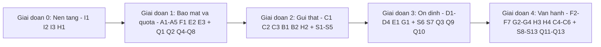

# Mail Service: yêu cầu chức năng sắp tới

Tài liệu này là **phần bổ sung** cho [mail-service-features.md](mail-service-features.md). File đó đã liệt kê hai nhóm chức năng:

- **S1–S13**: gửi email (API v1, queue, provider, retry, idempotency, template, batch, suppression, webhook…).
- **Q1–Q13**: kiểm soát quota theo API key (bắt buộc key, scope, rate limit, quota ngày/tháng, plan, dashboard usage…).

Tài liệu này **không chép lại** các mục đó, chỉ tham chiếu đến mã S/Q khi có liên quan. Các yêu cầu dưới đây là những mảng mà cả code hiện tại lẫn tài liệu cũ đều chưa đề cập.

**Phạm vi:** chỉ email **transactional**, tức email do hệ thống gửi đi như xác nhận đơn hàng, OTP, đặt lại mật khẩu, thông báo. Marketing nằm ngoài phạm vi (xem mục 13).

**Quy ước:**

- **Mã yêu cầu** có dạng `<Nhóm><số>`, ví dụ `A1`, `C3`.
- **Mức ưu tiên:**
  - **P0**: bắt buộc trước khi đưa ra cho hệ thống khác dùng.
  - **P1**: nên có ở bản phát hành ổn định.
  - **P2**: mở rộng sau.
- **Tiêu chí chấp nhận** là điều kiện kiểm chứng được, dùng khi nghiệm thu.

---

## 1. Tóm tắt các khoảng trống

| Nhóm | Khoảng trống | Bằng chứng trong code hiện tại | Mức độ |
| :--- | :--- | :--- | :--- |
| A. Xác thực quản trị | Mọi route quản trị đều mở. Danh tính người thao tác do client tự khai | [app.ts](../server/src/app.ts) mount `/api/api-keys`, `/api/usage-logs`, `/api/audit-logs`, `/api/mails` mà không có middleware xác thực. [request-context.ts](../server/src/middleware/request-context.ts) lấy `actor` thẳng từ header `X-Actor` | 🔴 Nghiêm trọng |
| B. Sandbox | Key `test` và `live` không khác nhau về hành vi | [lib/api-keys.ts](../server/src/lib/api-keys.ts) chọn `live`/`test` theo `NODE_ENV`, không theo từng key | 🟠 Cao |
| C. Vòng đời mail | Chưa có lịch sử sự kiện. Trạng thái có thể bị sửa tay. Mail bị xoá cứng | [schema.ts](../server/src/schema.ts) chỉ có `status` + `error`. `PATCH /api/mails/:id` cho phép đặt `SENT` từ ngoài. `DELETE` xoá hẳn dòng | 🟠 Cao |
| D. Domain người gửi | Chưa có khái niệm domain hay xác minh DNS | Không có bảng hay route liên quan. Tài liệu cũ mới chỉ xếp SPF/DKIM vào P2 dưới dạng "hướng dẫn" | 🟠 Cao |
| E. Dữ liệu và bảo mật | Không giới hạn thời gian lưu dữ liệu, không che PII, chưa có header bảo mật | Nội dung mail và usage log được giữ vĩnh viễn. Không dùng `helmet` | 🟠 Cao |
| F. Giao diện quản trị | Chỉ có form text, chưa có trang chi tiết mail và dashboard | [MailForm.tsx](../client/src/components/MailForm.tsx), [MailboxPage.tsx](../client/src/components/MailboxPage.tsx) | 🟡 Trung bình |
| G. Tài liệu API | Chưa có OpenAPI hay SDK. Tài liệu chỉ nằm trong README | [README.md](../README.md) | 🟡 Trung bình |
| H. Vận hành | Log dùng `console.*`, chưa có metrics, health check còn sơ sài | [routes/health.ts](../server/src/routes/health.ts) chỉ chạy `SELECT 1` | 🟡 Trung bình |
| I. Chất lượng và triển khai | Không có test, CI, Dockerfile cho app. Có script hỏng | [package.json](../package.json) gọi `db:push`, `db:studio` nhưng workspace server không định nghĩa. `engines.node >=20` trong khi README yêu cầu Node >= 22 | 🟠 Cao |

---

## 2. Nhóm A: Xác thực và phân quyền quản trị

> [!WARNING]
> Q1 (bắt buộc key cho `/api/v1/*`) chỉ có ý nghĩa khi nhánh `/api/admin/*` cũng được khoá. Hiện tại ai truy cập được cổng 4000 đều có thể tạo key, thu hồi key, xoá mail và ghi `actor` tuỳ ý vào audit trail.

| # | Ưu tiên | Chức năng | Mô tả | Tiêu chí chấp nhận |
| :- | :- | :--- | :--- | :--- |
| A1 | P0 | **Đăng nhập quản trị** | Có bảng `admin_users` (email, password hash argon2id, trạng thái). Đăng nhập tạo session cookie `HttpOnly`, `Secure`, `SameSite=Lax`, lưu ở Postgres. Có đăng xuất và hết hạn khi không hoạt động | Gọi `/api/admin/*` không có session → `401`. Sau khi đăng xuất, cookie cũ dùng lại → `401` |
| A2 | P0 | **Tách nhóm route admin** | Chuyển `/api/api-keys`, `/api/usage-logs`, `/api/audit-logs` và các thao tác quản trị mail sang `/api/admin/*`, tất cả đi qua middleware `requireAdminSession`. Đường dẫn cũ trả `410` hoặc redirect trong một phiên bản chuyển tiếp | Không còn route quản trị nào mount ngoài `/api/admin` mà thiếu middleware (kiểm bằng test liệt kê router) |
| A3 | P0 | **Actor lấy từ phiên đăng nhập** | `auditContext.actor` = email của admin đang đăng nhập. Bỏ qua header `X-Actor` đối với request admin. Với request dùng API key, actor = `api_key:<id>` | Gửi header `X-Actor: hacker` kèm session của alice → audit log ghi `alice@…` |
| A4 | P0 | **Phân quyền RBAC** | Ba vai trò: `owner` (quản lý admin và cấu hình), `admin` (quản lý key, domain, mail), `viewer` (chỉ đọc). Có middleware `requireRole(...)` | `viewer` gọi `POST /api/admin/api-keys` → `403 FORBIDDEN_ROLE` |
| A5 | P0 | **Chống CSRF** | Với route dùng cookie: kiểm tra header `Origin` và dùng token double-submit cho mọi method thay đổi dữ liệu | Request `POST` từ origin lạ → `403` |
| A6 | P1 | **Quản lý tài khoản admin** | `owner` mời admin mới (link có hạn), đổi vai trò, vô hiệu hoá tài khoản. Mọi thay đổi đều ghi `audit_logs` | Vô hiệu hoá một admin thì toàn bộ session đang mở của người đó mất hiệu lực ngay |
| A7 | P1 | **2FA (TOTP)** | Bật/tắt TOTP cho từng admin. Có thể bắt buộc với vai trò `owner` | `owner` chưa bật TOTP không thao tác được các chức năng nhạy cảm |
| A8 | P2 | **SSO (OIDC)** | Đăng nhập qua Google Workspace hoặc Azure AD. Map group của IdP sang vai trò | Tài khoản bị xoá ở IdP thì lần đăng nhập kế tiếp bị từ chối |

---

## 3. Nhóm B: Sandbox và môi trường test

Prefix `msk_test_` đã có nhưng đang phụ thuộc `NODE_ENV`. Khách tích hợp cần thử nghiệm mà **không gửi thư thật** và không tốn quota live.

| # | Ưu tiên | Chức năng | Mô tả | Tiêu chí chấp nhận |
| :- | :- | :--- | :--- | :--- |
| B1 | P0 | **Chọn môi trường cho từng key** | Thêm cột `api_keys.environment` (`test` / `live`), chọn khi tạo key. Prefix sinh theo cột này chứ không theo `NODE_ENV` | Tạo key `test` trên server production vẫn ra `msk_test_…` |
| B2 | P0 | **Key test không gửi thật** | Mail gửi bằng key `test` đi qua `SandboxProvider`: không ra mạng, được đánh dấu `SENT` ngay và lưu vào "hộp thư test" | Gửi bằng key test → provider thật không được gọi (kiểm bằng mock), mail xem được trong UI sandbox |
| B3 | P1 | **Địa chỉ giả lập kết quả** | Các địa chỉ đặc biệt như `bounce@sandbox.local`, `complaint@sandbox.local`, `delay@sandbox.local` sinh ra sự kiện tương ứng (C1) và webhook (S13) | Gửi tới `bounce@sandbox.local` → nhận webhook `bounced` đã ký HMAC |
| B4 | P1 | **Quota riêng cho test** | Key test có quota thấp và cố định (ví dụ 100 mail/ngày), không cộng vào quota live (Q4) | Dùng hết quota test thì quota live không đổi |
| B5 | P2 | **Tự dọn dữ liệu sandbox** | Mail sandbox tự xoá sau 7 ngày | Job dọn dẹp (E1) xoá đúng các mail sandbox quá hạn |

---

## 4. Nhóm C: Vòng đời và sự kiện của mail

| # | Ưu tiên | Chức năng | Mô tả | Tiêu chí chấp nhận |
| :- | :- | :--- | :--- | :--- |
| C1 | P0 | **Bảng sự kiện `mail_events`** | Append-only, mỗi dòng gồm `mail_id`, `type` (`queued`, `sending`, `sent`, `delivered`, `deferred`, `bounced`, `complained`, `failed`, `cancelled`), `occurred_at`, `provider_payload` (jsonb, đã lọc) và `attempt` | Mỗi lần đổi trạng thái đều sinh đúng một event. Có trigger chặn `UPDATE`/`DELETE` |
| C2 | P0 | **Máy trạng thái chặt chẽ** | Thêm trạng thái `SENDING` và `CANCELLED`. Chỉ worker hoặc webhook của provider được chuyển trạng thái. **Bỏ** khả năng đặt `SENT` qua `PATCH /api/mails/:id` | `PATCH {status:"SENT"}` → `400`/`405`. Chuyển `FAILED → SENT` không qua retry → bị từ chối |
| C3 | P0 | **Nhận webhook inbound từ provider** | Endpoint `POST /api/providers/:provider/events` nhận bounce/complaint/delivery, xác thực chữ ký của provider, map sang `mail_events`. Đây là nguồn dữ liệu cho S12 (suppression) và S13 (webhook gửi ra) | Payload sai chữ ký → `401`. Hard bounce → địa chỉ vào suppression list |
| C4 | P1 | **Huỷ mail** | `POST /api/v1/mails/:id/cancel` chỉ áp dụng cho mail `QUEUED` (kể cả mail hẹn giờ S11). Mail đã huỷ được hoàn lại quota | Huỷ mail đang `SENDING`/`SENT` → `409 MAIL_NOT_CANCELLABLE` |
| C5 | P1 | **Gửi lại (resend)** | Admin hoặc key gửi lại mail `FAILED`/`BOUNCED` thành **mail mới** có `resent_from_id`, trừ quota như một mail mới | Mail gốc giữ nguyên, mail mới liên kết ngược về mail gốc |
| C6 | P1 | **Xoá mềm mail** | Thay `DELETE` cứng bằng `deleted_at`. Nội dung được xoá thật bởi job lưu trữ (E1) | Mail đã xoá không còn xuất hiện trong danh sách nhưng usage log vẫn tham chiếu được |
| C7 | P2 | **Metadata và tag** | Trường `metadata` (jsonb, tối đa 2 KB) và `tags[]` do khách gửi kèm, trả lại trong webhook, lọc được trong UI | Lọc `GET /api/v1/mails?tag=order` trả đúng tập mail |

---

## 5. Nhóm D: Quản lý domain người gửi

Nhóm này nâng mục "hướng dẫn SPF/DKIM/DMARC" (P2 cũ) thành chức năng thật và là điều kiện cho S7 (domain được phép).

| # | Ưu tiên | Chức năng | Mô tả | Tiêu chí chấp nhận |
| :- | :- | :--- | :--- | :--- |
| D1 | P0 | **Đăng ký domain** | Bảng `sender_domains` (`domain`, `status`: `PENDING`/`VERIFIED`/`FAILED`, `verified_at`). Admin thêm domain qua UI/API | Chỉ được gửi `from` thuộc domain `VERIFIED`, nếu không → `403 SENDER_NOT_ALLOWED` |
| D2 | P0 | **Sinh bản ghi DNS** | Sinh TXT xác minh quyền sở hữu, SPF include, CNAME/TXT DKIM và gợi ý DMARC. Hiển thị để khách copy | UI hiển thị đủ bản ghi, nút copy hoạt động |
| D3 | P0 | **Kiểm tra xác minh** | Nút "Kiểm tra ngay" và job định kỳ (mỗi 6 giờ) dùng `dns.resolveTxt`/`resolveCname`. Domain đã `VERIFIED` mà sau đó mất bản ghi thì chuyển `FAILED` và cảnh báo | Gỡ bản ghi DKIM → trong một chu kỳ domain chuyển `FAILED` và sinh audit log |
| D4 | P1 | **Gắn domain với API key** | Mỗi key chọn một hoặc nhiều domain đã xác minh (thay cho `allowed_senders` dạng text tự do) | Key A không gửi được bằng domain chỉ gán cho key B |
| D5 | P1 | **Ký DKIM** | Khi tự gửi qua SMTP thì quản lý cặp khoá DKIM cho từng domain: private key mã hoá at-rest, xoay khoá có giai đoạn chồng lấn | Mail gửi đi pass DKIM khi kiểm bằng công cụ như mail-tester |
| D6 | P2 | **Return-Path / bounce domain riêng** | CNAME `bounces.<domain>` để căn chỉnh SPF (alignment) cho DMARC | DMARC aggregate report cho thấy SPF aligned |

---

## 6. Nhóm E: Dữ liệu, bảo mật và tuân thủ

| # | Ưu tiên | Chức năng | Mô tả | Tiêu chí chấp nhận |
| :- | :- | :--- | :--- | :--- |
| E1 | P0 | **Chính sách lưu trữ và job dọn dẹp** | Cấu hình qua env: nội dung mail (`subject/body/html`) giữ N ngày (mặc định 30) rồi xoá trắng, giữ lại metadata. `mail_events` và `api_key_usage_logs` giữ 13 tháng, sau đó partition theo tháng và drop | Mail quá hạn còn metadata, `body` bằng `NULL`. Job chạy idempotent |
| E2 | P0 | **Header bảo mật và giới hạn request** | Dùng `helmet` (CSP cho SPA, HSTS ở production). Rate limit theo IP cho `/api/admin/login` và toàn nhánh admin | Đăng nhập sai 10 lần/phút → `429` |
| E3 | P0 | **Không lộ PII và secret trong log** | Logger (H1) che email người nhận (`k***@example.com`), không bao giờ log body mail, header `Authorization` hay cookie | Test: log của một request gửi mail không chứa địa chỉ đầy đủ hay API key |
| E4 | P1 | **Đánh dấu nội dung nhạy cảm** | Cờ `sensitive: true` (dành cho OTP, reset password): body không được lưu sau khi gửi xong, UI chỉ hiện `[redacted]` | Mail `sensitive` sau khi `SENT` có `body = NULL` |
| E5 | P1 | **Xoá dữ liệu theo yêu cầu chủ thể** | Endpoint admin `POST /api/admin/data-subjects/erase {email}` ẩn danh hoá mọi mail/sự kiện liên quan tới địa chỉ đó (đáp ứng GDPR / Nghị định 13/2023/NĐ-CP) và ghi audit | Sau khi xoá, tìm theo email không còn kết quả. Audit log ghi hash của email, không ghi email gốc |
| E6 | P1 | **Mã hoá cột nhạy cảm** | Mã hoá at-rest (AES-256-GCM, khoá lấy từ env/KMS) cho DKIM private key, secret của webhook (S13), thông tin đăng nhập provider nếu lưu trong DB | Đọc thẳng DB không thấy giá trị rõ |
| E7 | P2 | **Giới hạn IP truy cập trang admin** | Allowlist CIDR cho nhánh `/api/admin` | IP ngoài danh sách → `403` |

---

## 7. Nhóm F: Giao diện quản trị

| # | Ưu tiên | Chức năng | Mô tả | Tiêu chí chấp nhận |
| :- | :- | :--- | :--- | :--- |
| F1 | P0 | **Màn hình đăng nhập và phân quyền trên UI** | Trang login, hiện người dùng hiện tại, ẩn hoặc vô hiệu hoá nút theo vai trò (A1, A4) | `viewer` không thấy nút tạo, thu hồi hay xoá key |
| F2 | P1 | **Trang chi tiết mail** | Thông tin đầy đủ, timeline `mail_events` (C1), key đã gửi, số lần thử, lỗi provider. Có nút huỷ (C4) và gửi lại (C5) | Mở từ danh sách hoặc qua deep link `#mails/<id>` |
| F3 | P1 | **Xem trước HTML an toàn** | Render `html` trong `<iframe sandbox>` không cho chạy script, chặn ảnh từ xa mặc định. Có tab xem text và raw | Mail chứa `<script>` không thực thi |
| F4 | P1 | **Trang domain** | Danh sách domain, trạng thái, bản ghi DNS, nút kiểm tra lại (D1–D3) | Thêm domain → thấy bản ghi cần cấu hình ngay |
| F5 | P1 | **Dashboard tổng quan** | Số mail theo ngày, tỉ lệ `delivered/bounced/failed`, top key theo lượng dùng, độ dài hàng đợi. Phần biểu đồ theo từng key do Q11 đảm nhiệm | Dữ liệu khớp với truy vấn SQL đối chiếu trong cùng khoảng thời gian |
| F6 | P1 | **Trang suppression, webhook, template** | Giao diện CRUD cho S12, S13, S8: thêm hoặc gỡ địa chỉ bị chặn, gửi webhook thử, chỉnh và xem trước template theo version | Gửi webhook test → hiển thị mã phản hồi và thời gian |
| F7 | P1 | **Hộp thư sandbox** | Xem các mail gửi bằng key test (B2) | Chỉ hiện mail sandbox, có nhãn rõ ràng |
| F8 | P2 | **Xuất CSV** | Xuất danh sách mail, usage log, audit log theo bộ lọc hiện tại (stream phía server, tối đa 100k dòng) | File mở đúng tiếng Việt (UTF-8 có BOM) |
| F9 | P2 | **Phân trang cursor và thao tác hàng loạt** | Chuyển từ `offset` sang cursor `(created_at, id)` cho bảng lớn. Chọn nhiều để huỷ hoặc gửi lại | Trang 1000 phản hồi nhanh tương đương trang 1 |
| F10 | P2 | **Đa ngôn ngữ UI** | Tách chuỗi ra file i18n (vi/en) | Đổi ngôn ngữ không cần reload |

---

## 8. Nhóm G: Tài liệu API và trải nghiệm developer

| # | Ưu tiên | Chức năng | Mô tả | Tiêu chí chấp nhận |
| :- | :- | :--- | :--- | :--- |
| G1 | P0 | **Đặc tả OpenAPI 3.1** | Sinh từ chính các schema `zod` đang dùng để validate, để tài liệu không lệch khỏi code. Phục vụ tại `/api/v1/openapi.json` | CI fail nếu spec sinh ra khác với file đã commit |
| G2 | P1 | **Trang tài liệu tương tác** | Redoc hoặc Swagger UI tại `/docs`, gồm ví dụ curl, bảng mã lỗi và hướng dẫn xác thực | Mọi endpoint public đều có ví dụ request/response |
| G3 | P1 | **Chính sách version và deprecation** | Quy ước thay đổi breaking chỉ đi kèm version mới (`/api/v2`), header `Deprecation` và `Sunset` cho endpoint cũ, changelog | Endpoint đánh dấu deprecated trả đủ hai header |
| G4 | P1 | **SDK Node.js** | Package `@mail-service/node`: hàm `send`, `getMail`, `getQuota`, tự sinh `Idempotency-Key`, retry khi gặp `429` theo `Retry-After`, helper xác minh chữ ký webhook | Ví dụ trong README chạy được với key sandbox |
| G5 | P2 | **Ví dụ cho ngôn ngữ khác** | Snippet PHP, Python, Java, .NET trong tài liệu | |

---

## 9. Nhóm H: Vận hành và quan sát

| # | Ưu tiên | Chức năng | Mô tả | Tiêu chí chấp nhận |
| :- | :- | :--- | :--- | :--- |
| H1 | P0 | **Log có cấu trúc** | Thay `console.*` bằng `pino` (JSON), mỗi dòng có `requestId`, `apiKeyId`, `mailId`, level đặt qua env. Áp dụng quy tắc che PII (E3) | Lọc log theo `requestId` ra đủ toàn bộ chuỗi xử lý của một request, kể cả phần worker |
| H2 | P0 | **Health check tách liveness / readiness** | `/api/health/live` chỉ kiểm process. `/api/health/ready` kiểm DB, worker heartbeat và kết nối provider | DB down → `ready` trả `503`, `live` vẫn `200` |
| H3 | P1 | **Metrics Prometheus** | Endpoint `/metrics` (chỉ mở trong mạng nội bộ): request theo route/status, độ dài hàng đợi, tuổi job cũ nhất, số lần gửi theo provider/kết quả, số lần chặn vì quota | Có đủ các metric trên, có dashboard Grafana mẫu |
| H4 | P1 | **Cảnh báo vận hành** | Cảnh báo khi hàng đợi kẹt (job cũ nhất quá 5 phút), tỉ lệ lỗi provider quá 5%, domain mất xác minh (D3), bounce rate quá ngưỡng | Có ngưỡng cấu hình được và runbook cho từng cảnh báo |
| H5 | P2 | **Tracing (OpenTelemetry)** | Trace từ API → DB → worker → provider | Xem được một trace đầy đủ cho một mail |

---

## 10. Nhóm I: Chất lượng và triển khai

| # | Ưu tiên | Chức năng | Mô tả | Tiêu chí chấp nhận |
| :- | :- | :--- | :--- | :--- |
| I1 | P0 | **Bộ test tự động** | Vitest + Supertest, Postgres thật (testcontainers hoặc DB riêng cho test). Bắt buộc có test cho: xác thực admin và key, scope, **quota atomic** (50 request đồng thời), idempotency, máy trạng thái mail (C2) | `npm test` chạy được trên máy sạch. Các checklist ở mục 10 của tài liệu cũ đều có test tương ứng |
| I2 | P0 | **CI** | GitHub Actions: cài dependency → typecheck → lint → test → build cho cả hai workspace | PR không merge được khi CI đỏ |
| I3 | P0 | **Sửa cấu hình đang lệch** | Gỡ hoặc bổ sung script `db:push` / `db:studio` đang được gọi mà workspace server không có. Đặt `engines.node` = `>=22` cho khớp README (server cần type-stripping). Chỉ dùng **một** package manager: hiện có cả `npm` workspaces lẫn `server/pnpm-lock.yaml` chưa commit | `npm run db:push` hoặc chạy được, hoặc không còn tồn tại. Chỉ còn một loại lockfile |
| I4 | P1 | **Đóng gói container** | Dockerfile multi-stage cho API, worker và client build. `docker-compose` chạy được cả stack (db + api + worker) | `docker compose up` cho ra hệ thống chạy được, health `ready` = 200 |
| I5 | P1 | **Quy trình migration** | Mỗi migration có bản rollback hoặc ghi chú không đảo ngược được. Kiểm tra migration trên bản sao dữ liệu trong CI. Khoá advisory lock để tránh chạy migrate song song | Hai tiến trình migrate cùng lúc → chỉ một tiến trình áp migration |
| I6 | P2 | **Seed và fixture phong phú** | Seed sinh admin mặc định (chỉ ở dev), key test, domain mẫu và mail ở đủ các trạng thái | UI dev có dữ liệu cho mọi màn hình |

---

## 11. Bảng ưu tiên tổng hợp

| Ưu tiên | Mã yêu cầu |
| :--- | :--- |
| **P0** | A1, A2, A3, A4, A5 · B1, B2 · C1, C2, C3 · D1, D2, D3 · E1, E2, E3 · F1 · G1 · H1, H2 · I1, I2, I3 |
| **P1** | A6, A7 · B3, B4 · C4, C5, C6 · D4, D5 · E4, E5, E6 · F2–F7 · G2, G3, G4 · H3, H4 · I4, I5 |
| **P2** | A8 · B5 · C7 · D6 · E7 · F8, F9, F10 · G5 · H5 · I6 |

---

## 12. Lộ trình: ghép với 4 giai đoạn của tài liệu cũ

| Giai đoạn | Kết quả bàn giao | Lý do thứ tự |
| :--- | :--- | :--- |
| 0. Nền tảng | Có test, CI, log có cấu trúc, cấu hình hết lệch | Cần lưới an toàn trước khi động vào auth và quota |
| 1. Bảo mật | Trang admin cần đăng nhập, audit ghi đúng người thao tác, API public bắt buộc key | Khoá route admin (A) là điều kiện để Q1 có ý nghĩa |
| 2. Gửi thật | Gửi qua provider, có lịch sử sự kiện, có sandbox cho khách thử | Có `mail_events` và sandbox thì việc tích hợp provider mới kiểm chứng được |
| 3. Ổn định | Domain đã xác minh, dữ liệu có hạn lưu trữ, có OpenAPI | Cần trước khi mở cho khách bên ngoài |
| 4. Vận hành | Dashboard, cảnh báo, SDK, các trang quản trị còn lại | Giá trị cao nhưng không chặn việc đưa vào dùng |

---

## 13. Ngoài phạm vi

- Email marketing: danh bạ/audience, chiến dịch gửi hàng loạt, A/B test, phân khúc người nhận.
- Nhận mail (inbound mailbox, parse email đến). C3 chỉ nhận **sự kiện** từ provider, không nhận thư.
- Trình soạn email kéo thả. Template (S8) chỉ dùng HTML/biến.
- Tính tiền và thanh toán (overage billing ở mục 3.3 của tài liệu cũ vẫn để P2).

---

## 14. Câu hỏi mở cần nghiệp vụ chốt

1. **Provider chính** là gì (SMTP nội bộ, Amazon SES, SendGrid…)? Câu trả lời quyết định C3 (định dạng webhook inbound) và D5 (có phải tự ký DKIM không).
2. **Đăng nhập admin**: tài khoản nội bộ (A1) là đủ, hay cần SSO (A8) ngay từ đầu?
3. **Thời hạn lưu trữ** nội dung mail và log (E1): 30 ngày / 13 tháng có phù hợp với yêu cầu pháp lý và đối soát không?
4. **Multi-tenant**: có nhiều tổ chức/dự án độc lập dùng chung hệ thống không? Nếu có, cần thêm tầng `organizations` phía trên `api_keys`, `sender_domains`, `admin_users`, và nhiều yêu cầu ở trên sẽ phải gắn thêm `organization_id`.
5. **SLA**: độ trễ gửi mục tiêu (ví dụ p95 dưới 30 giây từ lúc `QUEUED` đến lúc `SENT`) để đặt ngưỡng cảnh báo cho H4.
